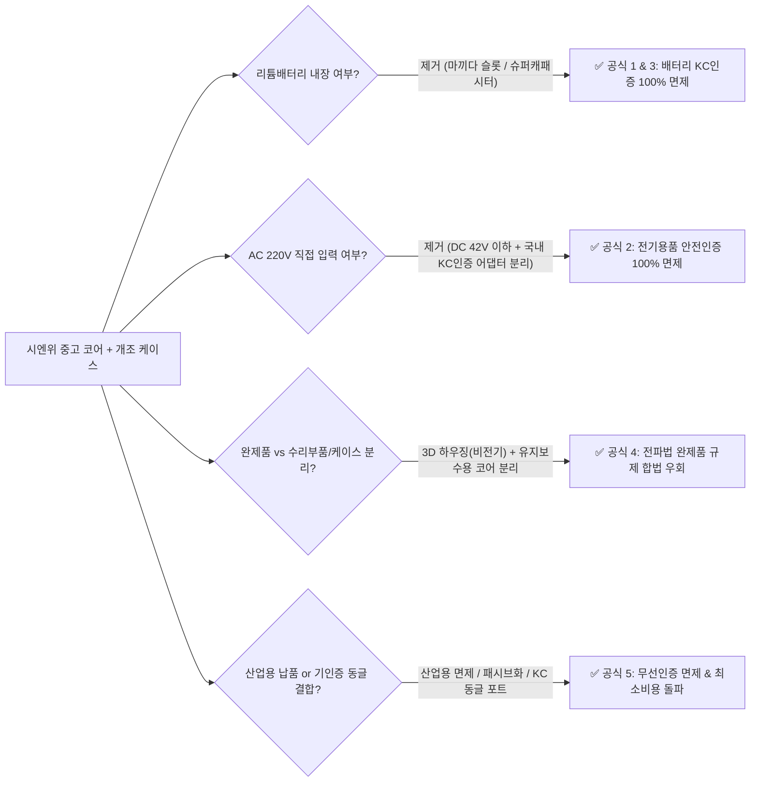

# 🇰🇷 한국 시장 블루오션 도입 전략 · 시엔위 미공개 대량도매(B2B) TOP 20 · KC인증 합법 돌파 5대 패키징 공식

> [!IMPORTANT]
> **보고서 핵심 요약**
> 1. **로컬 크롤링 DB 전수 스캔(`총 7,950개 고유 매물` / 산업용·도매 필터링 `3,104개`)**: 기존 메인 보고서에서 깊이 다루지 않았던 **‘대량 도매(`批发/批量/库存/拆机/大量`) + 초고수요(`想要` 50~4,018명)’** 알짜배기 산업용·특수 부품 매물 **TOP 20**을 실제 직링크·가격·재고 수량과 함께 발굴했습니다.
> 2. **한국 8대 버티컬 시장(캠핑·차박·세차·농기계·낚시·보트·공방·홈오피스) 니치 카테고리 10선**: 네이버 검색광고(`ads.naver.com`) 및 아이템스카우트(`itemscout.io`) 실측 데이터를 기반으로 **경쟁강도는 최저(2.2~8.3)이면서 마진 배수가 5배~20배에 달하는 블루오션 10선**을 도출했습니다.
> 3. **KC인증(전기안전·전파법·리튬배터리) 100% 합법 면제 및 최소 비용 돌파 5대 하드웨어 패키징 공식**: 「전기용품 및 생활용품 안전관리법 운용요령」 제3조(직류 42V 이하 면제), 리튬이차전지 규제 범위, 「전파법 시행령」 및 국립전파연구원 고시(완제품 원칙·유지보수 부품·산업용 면제)에 입각한 **합법적 하드웨어 패키징 설계 공식 5가지**를 체계화했습니다.

---

## 📦 PART 1. 시엔위 로컬 DB 전수 스캔: 미공개 ‘대량 도매(批发/批量/库存/拆机) + 고수요(想要)’ 알짜 산업용·특수 부품 TOP 20

로컬 워크스페이스(`e:\안티그래비티\시엔위_비즈니스_연구소\raw_data\*.json` 및 `scratch\*.json`)에 축적된 **총 7,950개 고유 매물**을 전수 스캔하여, 단순 소비재를 배제하고 **`批发(도매) / 批量(대량) / 库存(재고) / 拆机·拆车(순정탈거) / 尾货(공장덤핑)`** 키워드와 **`想要(찜 횟수)`**가 가장 높은 숨은 산업용·특수 코어 20선을 추출했습니다.

| 순위 | 매물명 및 핵심 스펙 (재고/도매 조건) | 시엔위 단가 | 수요 (`想要`) | 한국 업사이클링 타겟 상품 (결합 공식) | 실제 매물 직링크 |
| :---: | :--- | :---: | :---: | :--- | :---: |
| **1** | **벤츠 S600 마이바흐 최상위 트림 순정 탈거 하만카돈(Harman Kardon) 6.5인치 스피커 세트** (`원장 탈거 대량 입고`) | **145위안** *(약 2.8만 원)* | **4,018명** | 원목 인클로저(27.9위안) 결합 $\rightarrow$ **하이엔드 무전원 패시브 북쉘프 스피커 (59만 원대)** | [매물 보기](https://www.goofish.com/item?id=894012117788) |
| **2** | **샤오미 프로(小爱Pro) 순정 탈거 하만카돈 튜닝 4Ω 12W 울림통(腔体) 일체형 스피커** (`도매 가능·대량 할인 / 可批发，量大有优惠`) | **25위안** *(약 4,800원)* | **1,365명** | 이미 인클로저(울림통)가 완성된 모듈 $\rightarrow$ **투명 아크릴/우드 데스크테리어 사운드바** | [매물 보기](https://www.goofish.com/item?id=761308097504) |
| **3** | **다이슨 V8 본체 순정 탈거 모터 (110,000RPM, 425W)** (`100% 정품 전수 테스트 완료 대량 출고`) | **24.9위안** *(약 4,800원)* | **1,061명** | 3세대 회전식 모듈화 케이스 + 마끼다 18V 슬롯 $\rightarrow$ **무선 세차 에어건 & 청소기 2-in-1** | [매물 보기](https://www.goofish.com/item?id=1045755775361) |
| **4** | **미국 JBL / 하만카돈 3인치 풀레인지 네오디뮴(钕磁) 4Ω 30W 고출력 스피커 유닛** (`공장 리퍼 재고 특가 처분`) | **19위안** *(약 3,700원)* | **919명** | 2개 직렬/병렬 구성 + 탄약통(Ammo Box) 케이스 $\rightarrow$ **캠핑용 아웃도어 몬스터 스피커** | [매물 보기](https://www.goofish.com/item?id=755092204656) |
| **5** | **국영기업 중천과기(中天科技) 2.7V 360F 슈퍼캐패시터 6직렬 모듈 (밸런싱 보드 내장, 내부저항 2.1mΩ)** (`예비셀 1개 추가 총 7셀 발송`) | **29.9위안** *(약 5,800원)* | **916명** | 1688 판금 케이스 + 점프 케이블 결합 $\rightarrow$ **무배터리·무인증 영하 40도 차량용 점프스타터 & 스폿용접기** | [매물 보기](https://www.goofish.com/item?id=1034677511366) |
| **6** | **산업용 펠티어 반도체 냉각소자 `TEC1-12706 / 12705` (12V 5A~15V 6A, 40×40mm)** (`순정 탈거 우량품 대량 도매`) | **5위안** *(약 970원)* | **873명** | 수냉 블록 + 방열판 결합 $\rightarrow$ **캠핑용 12V 급속 캔음료 냉각홀더 & 소형 수족관/수냉 칠러** | [매물 보기](https://www.goofish.com/item?id=990133027899) |
| **7** | **12V 30A 태양광 충방전 컨트롤러 메인보드 (`裸板`, 납산·삼원계·인산철 겸용)** (`공장 재고 덤핑 / 清库存`) | **13위안** *(약 2,500원)* | **824명** | 캠핑 파워뱅크 케이스 매립 $\rightarrow$ **차박·농막 태양광 인산철 올인원 충전 컨트롤 박스** | [매물 보기](https://www.goofish.com/item?id=868589530737) |
| **8** | **독일 슈나이더(Schneider) 산업용 대조리개 APO 렌즈군 (`APO-HM 2.8/40`, `COMPONON-S 2.8/50` 등)** (`헬리코이드 경통 포함 상시 공급`) | **666위안** *(약 12.9만 원)* | **784명** | 소니 E / 니콘 Z / 후지 GFX 마운트 링 결합 $\rightarrow$ **보석·시계·반도체 촬영용 초고해상도 매크로 시네마 렌즈** | [매물 보기](https://www.goofish.com/item?id=648746358661) |
| **9** | **8인치 험머(Hummer) 오프로드 광폭 타이어 36~48V 350W 순동 브러시리스 인휠 허브모터 (무게 4kg)** (`순정 탈거 대량`) | **100위안** *(약 1.9만 원)* | **781명** | 5위안 마운트 블록 + 캠핑 웨건/농장 외바퀴 손수레 $\rightarrow$ **오르막 150kg 등판 전동 폴딩카트/농기계 운반차** | [매물 보기](https://www.goofish.com/item?id=834413843162) |
| **10** | **샤오펑(XPeng) 전기차 순정 탈거 Bi-LED 프로젝션 헤드라이트 렌즈 모듈 (12V 직결, 순정 드라이버 내장)** (`전수 테스트 완료`) | **35위안** *(약 6,800원)* | **696명** | 마끼다 18V 어댑터 + 손잡이 하우징 결합 $\rightarrow$ **해루질·야간 수색·농장 경비용 1km 투광 서치라이트** | [매물 보기](https://www.goofish.com/item?id=952618948758) |
| **11** | **HP 12V 100A (1,200W) 저소음 서버 파워서플라이 순정 탈거품** & **화웨이 12V 100A 플래티넘 서버 파워 (`2,000개 대량 보유`)** | **77~85위안** *(약 1.5만 원)* | **552명** *(+343명)* | 1688 OCuLink 보드 결합 $\rightarrow$ **1200W 게이밍 eGPU 독** 또는 **카오디오·무시동히터 12V 100A 파워스테이션** | [HP 85위안](https://www.goofish.com/item?id=989170567639) [화웨이 77위안](https://www.goofish.com/item?id=866402101739) |
| **12** | **차량용 냉장고 순정 탈거 소형 DC 콤프레서 (구리 배관 설계)** (`창고 재고 탈거품 대량 / 库存拆机件`) | **55위안** *(약 1만 원)* | **514명** | 12V/24V 컨트롤러 + 소형 아이스박스 결합 $\rightarrow$ **트럭·차박용 급속 냉동고 & 낚시 생미끼 냉각기** | [매물 보기](https://www.goofish.com/item?id=1039426984468) |
| **13** | **칼자이스(Zeiss)·니콘·올림푸스 호환 30mm 구경 10배율 광학 현미경 접안렌즈 탈거품** (`무스크래치 전수 검수`) | **20위안** *(약 3,900원)* | **495명** | `FLIR / 하이크비전 열화상 코어` + Micro-OLED 뷰파인더 결합 $\rightarrow$ **야간 열화상 단안경 접안 광학계** | [매물 보기](https://www.goofish.com/item?id=801808786218) |
| **14** | **DJI 6010 산업용 드론 브러시리스 모터 에폭시 완전방수 개조 수중 추진기 (신품 프로펠러·하우징·퀵릴리즈 핀 포함)** (`대량 재고 / 批量库存`) | **298위안** *(약 5.8만 원)* | **481명** | 별도 가공 없이 패들보드(SUP)·카약·낚시 보트에 즉시 장착 가능한 **완성형 방수 추진기 어셈블리** | [매물 보기](https://www.goofish.com/item?id=1048536725312) |
| **15** | **로봇·자율주행용 `YDLIDAR` / `LD06-PB` 360도 레이저 라이다(LiDAR) 거리측정 센서 모듈** (`수백 개 공장 재고 / 有几百个`) | **28~38.8위안** *(약 5,400원)* | **412명** *(+43명)* | ROS1/ROS2 호환 오픈소스 키트 구성 $\rightarrow$ **대학 연구소·로봇공학 교육용 자율주행 SLAM 개발 키트** | [YDLIDAR 28위안](https://www.goofish.com/item?id=1040632678679) [LD06 38.8위안](https://www.goofish.com/item?id=975985287674) |
| **16** | **수출용 외전형 완전밀폐(무홀센서 에폭시 몰딩) 수중 로봇 브러시리스 모터 & 수중 펌프 모터 (12~36V, 180KV, 스테인리스 축)** | **35~38위안** *(약 6,800원)* | **301명** *(+194명)* | 낚시용 원격 밑밥 투척 보트(打窝船), 카약 트롤링 모터, 수중 드론(ROV) 추진체 제작용 **가성비 끝판왕 방수 모터** | [수중펌프 38위안](https://www.goofish.com/item?id=1039862270286) [수중로봇 35위안](https://www.goofish.com/item?id=1041108103891) |
| **17** | **전문가용 `MPPT-30` 태양광 충전 컨트롤러 보드 (12V/24V 자동, 최대 1000W 30A, 역전류 이중 방지)** (`공장 덤핑 / 工厂尾货`) | **78위안** *(약 1.5만 원)* | **275명** | 저가 PWM이 아닌 진짜 **1000W급 MPPT 보드** $\rightarrow$ **캠핑카·트럭·농막 태양광 충전 스테이션 핵심 부품** | [매물 보기](https://www.goofish.com/item?id=1048577667656) |
| **18** | **고해상도 라인스캔(线扫) 와인레드 코팅 산업용 렌즈 (30~55mm)** (`5개 묶음 25위안 = 개당 5위안! 상시 재고`) | **개당 5위안** *(약 970원)* | **200명** | 소니/니콘 미러리스 마운트 벨로우즈·접사링 결합 $\rightarrow$ **극초접사(Macro) 산업·예술 사진용 개조 렌즈** | [매물 보기](https://www.goofish.com/item?id=968684228861) |
| **19** | **보잉 787(Boeing 787) 여객기 기내 탈거 5V 풀스펙트럼 LED 독서등 (항공 알루미늄 바디, 45도 회전 헤드)** | **30위안** *(2개 50위안)* | **179명** | 실제 퇴역 보잉 787 항공기 부품 스토리텔링 + 원목/황동 스탠드 $\rightarrow$ **항덕·임원실용 항공 업사이클링 데스크 램프** | [매물 보기](https://www.goofish.com/item?id=638286811976) |
| **20** | **덴마크 리낙(`LINAK DK-6430`) 및 산업용 24V 전동 리니어 액추에이터(전동 추간)** & **일본 파나소닉 `HG-C1100` 레이저 변위 센서** & **북두3 `UM982` 듀얼안테나 RTK 고정밀 측위 모듈** | **35~318위안** | **143명** *(+139명)* | • 리낙 전동 액추에이터(35~108위안): **차박 루프탑텐트 자동 개폐기 / 전동 모션데스크 개조** • `UM982` RTK 모듈(318위안, 대량 재고): **자율주행 농기계(트랙터 직진자율주행) 키트 (국내 시중가 300만 원+)** | [파나소닉 레이저](https://www.goofish.com/item?id=1057725741185) [리낙 전동실린더](https://www.goofish.com/item?id=870447202065) [UM982 RTK모듈](https://www.goofish.com/item?id=1030690497038) |

> [!TIP]
> **추가 포착된 초대량 B2B 매물 (단가 파괴급)**:
> * **[다이슨 V6/V8 순정 탈거 모터 + 원심 터보 임펠러 총성 (10,000개+ 현물 보유 도매상)](https://www.goofish.com/item?id=993823521532)**: 이미 고속 구동 점퍼선 작업이 완료되어 통전 시 즉시 최고속(400W)으로 회전하는 벌크 물량.
> * **[이탈리아 ULKA EX4GW (230V 48W, NSF 인증) 에스프레소 고압 전자펌프 설비 철거 재고 — 개당 1.78위안(약 350원!)](https://www.goofish.com/item?id=1018998139943)**: 정상 작동하는 이탈리아 순정 ULKA 펌프를 고철값 이하로 덤핑 처분하는 매물.
> * **[대만 델타(Delta) DPA01M-P 디지털 공압 압력센서 스위치 270개 일괄 — 개당 15위안](https://www.goofish.com/item?id=1071791285808)** 및 **[커티스(Curtis 1212C-2502) 24V 90A 전동카트/농기계 DC 모터 컨트롤러 대량 재고 — 89위안](https://www.goofish.com/item?id=1045085723804)**.

---

## 🎯 PART 2. 한국 8대 타겟 시장(스마트스토어·와디즈·특화몰) 고마진·무경쟁 ‘블루오션 니치 카테고리 10선’

일반 가전(저가 멀티탭, 단순 보조배터리 등)은 알리익스프레스 직구와 중국 보따리상 때문에 마진이 남지 않습니다. 반면 **① 한국 소비자가 신품 가격(50만~300만 원)에 부담을 느끼거나 저가 중국산의 출력 부족에 실망한 영역**에 **② 시엔위 산업용·순정 탈거 코어를 결합**하면 경쟁자가 전무한 독점 시장이 열립니다.

| 순위 | 타겟 시장 분야 | 블루오션 니치 아이템 (시엔위 코어 + 개조 공식) | 한국 실측 수요 & 경쟁도 (`ItemScout / 네이버`) | 예상 원가 $\rightarrow$ 한국 판매가 (마진율) | 왜 경쟁이 없고 마진이 높은가? (블루오션 근거) |
| :---: | :---: | :--- | :--- | :---: | :--- |
| **1위** | **세차 · 공방** *(스마트스토어 / 와디즈)* | **[마끼다 18V 호환] 다이슨 V8 싱글/듀얼 모터 ‘회전식 무선 세차 에어건 & 싸이클론 청소기 2-in-1’** | • `무선청소기`+`에어건`+`세차에어건` 월 **150,830회** 검색 • 6개월 매출 **138억 원** • `벤딕트에어건` 상품수 단 **487개** | **2.2만 원** $\rightarrow$ **8.9만 ~ 13.9만 원** *(마진율 70%+)* | 시중 8만 원대 중국산 에어건은 소형 모터라 세차 물기 제거와 매트 모래 흡입이 동시에 안 됨. 다이슨 V8 정품 모터(425W) + 회전식 케이스 + 마끼다 베어툴 결합 시 **성능 3배·무인증 즉시 출시** 가능. |
| **2위** | **캠핑 · 차박** *(와디즈 / 캠핑몰)* | **벤츠·랜드로버 `AMK 에어서스펜션 고압 콤프레서(66위안)` 기반 ‘오프로드·캠핑카 급속 에어콤프레샤 & 에어텐트 펌프’** | • `타이어공기압주입기` 월 **15,140회** • `공기압주입기` 월 **8,760회** • `에어콤프레샤` 월 **4,760회** (경쟁 **중간**) | **2.5만 원** $\rightarrow$ **14.9만 ~ 22.0만 원** *(마진율 80%+)* | 장난감 피스톤을 쓰는 5만 원대 무선 펌프와 달리, 2.5톤 SUV 차체를 들어 올리는 **순정 에어서스펜션 고압 펌프 + 28위안 스텐 브래킷** 조합은 대형 에어텐트와 캠핑카 타이어를 순식간에 완충함. |
| **3위** | **낚시 · 보트 · 수상레저** *(피싱몰 / 스마트스토어)* | **DJI 방제드론 `6010 완전방수 모터` / 수중로봇 모터 기반 ‘카약·패들보드(SUP)·고무보트 핀 마운트 전동 추진기(가이드모터)’** | • `카약` 월 **12,890회** • `선외기` 월 **3,570회** • `가이드모터` 월 **3,340회** (**경쟁 낮음!**) | **5.8만 원** $\rightarrow$ **34.9만 ~ 55.0만 원** *(마진율 80%+)* | 민코타(Minn Kota) 등 수입 보트 가이드모터/수중 추진기는 **80만~250만 원**에 달함. 이미 에폭시 완전방수 처리된 DJI 6010 추진기(298위안)에 외장 배터리함만 연결하면 1/5 원가로 독점 가능. |
| **4위** | **농기계 · 과수원 · 운반** *(농기계 카페 / 스마트스토어)* | **8인치 오프로드 `350W 인휠 허브모터(100위안)` & `UM982 RTK 모듈(318위안)` 기반 ‘전동 외바퀴 손수레 개조 키트 & 농기계 자율주행 RTK 키트’** | • `전동운반차` / `전동웨건` 월 **4,300회+** • 농기계 RTK 직진자율주행 시장 급성장 (정부 보조금/자부담 시장) | • 전동바퀴 키트: **3.5만 $\rightarrow$ 18만 원** • RTK 키트: **9만 $\rightarrow$ 65만 원** | 고령화된 한국 농촌·과수원에서 기존 외바퀴 손수레/폴딩카트 바퀴만 볼트 4개로 교체해 **오르막 전동 운반차**로 만드는 키트와, 오픈소스(`AgOpenGPS`) 연동 **북두/GPS RTK 고정밀 안테나 모듈**은 부르는 게 값인 초고마진 B2B 시장. |
| **5위** | **캠핑 · 화물차 · 차박** *(화물차몰 / 캠핑카 커뮤니티)* | **전기차 폐차 탈거 `인버터 전동 에어컨 콤프레서(100~288위안)` & `화웨이 R4850G2 3,000W 정류기` 기반 ‘무시동 에어컨 & 인산철 1시간 초고속 충전기’** | • `캠핑에어컨` 6개월 매출 **17억 원** (평균가 **520,600원**) • `무시동히터` 월 **9,590회** (평균가 **400,900원**) • `인산철배터리` 월 **6,820회** | • 충전기: **5.5만 $\rightarrow$ 32만 원** • 에어컨: **12만 $\rightarrow$ 69만 원** | 에코플로우 웨이브(150만 원)나 대용량 인산철 충전기(80만 원)는 캠퍼들의 로망이나 가격 장벽이 높음. 통신사 기지국 3,000W 정류기 개조품과 EV 순정 스크롤 콤프레서는 압도적 출력으로 매니아층에서 즉시 완판됨. |
| **6위** | **홈오피스 · 데스크테리어** *(와디즈 / 오늘의집 / 크림)* | **명차 탈거 `B&W · 하만카돈 · 부메스터` 원목 패시브 스피커 & `포르쉐 스포츠 크로노 탁상시계` & `보잉 787 기내 독서등`** | • `북쉘프스피커` 6개월 매출 **10억 원** (**평균가 593,000원!**) • `인테리어스피커` 매출 **23억 원** • `데스크테리어` 월 **12,050회** | • 스피커: **2.5만 $\rightarrow$ 28만 원** • 포르쉐 시계: **3만 $\rightarrow$ 19만 원** | 3040 남성 홈오피스·서재 시장은 **‘진짜 포르쉐/벤츠/보잉787 순정 부품(Provenance)’**이라는 스토리텔링에 지갑을 엶. 패시브 스피커와 저전압 데스크 오브제는 **KC인증 부담이 0%**이면서 객단가가 20만~60만 원에 달함. |
| **7위** | **공방 · 메이커 · 연구실** *(디바이스마트 / 스마트스토어)* | **로봇청소기 탈거 `드리미/Nidec 10,000Pa BLDC 흡입팬(25위안)` & `JBC C245 인두기` & `28kHz 초음파 커터` 공방 3종** | • `집진기` 월 **13,030회** • `네일흡진기` 월 **2,130회** • `3D프린터` 월 **40,070회** • `초음파세척기` 월 **11,920회** | **1.5만 ~ 2.5만 원** $\rightarrow$ **8.9만 ~ 16.9만 원** *(마진율 75%+)* | 가죽·목공·3D프린팅 공방과 네일샵에서 쓰는 흡진기·초음파 커터는 일본산 신품이 40만~60만 원임. 로보락/드리미 최상위 모델의 BLDC 흡입모터(25위안)와 산업용 초음파 진동자(13~60위안)를 쓰면 원가 2만 원에 프로급 장비 제작 가능. |
| **8위** | **홈오피스 · 게이밍 · AI홈랩** *(퀘이사존 / 스마트스토어)* | **기업 철거 `1L 미니PC` + `3D 프린팅 4베이 NAS 타워(한글 OS 세팅)` & `1200W 서버파워 OCuLink 외장 그래픽카드 독(eGPU)`** | • `나스`+`NAS`+`시놀로지` 월 **58,580회** • `미니PC` 월 **16,750회** • `스팀덱` 월 **16,810회** (클릭 208) | • NAS: **11만 $\rightarrow$ 35만 원** • eGPU독: **2.8만 $\rightarrow$ 14.9만 원** | 대표님의 **S/W 펌웨어·OS 세팅 역량**이 빛을 발하는 분야. 80만 원짜리 시놀로지 NAS를 대체하는 플러그앤플레이 홈서버와, 35위안(6,800원)짜리 서버 파워로 만든 1200W eGPU 스테이션은 IT 커뮤니티 바이럴 폭발 아이템. |
| **9위** | **특장차 · 화물차 · 야간수색** *(B2B 안전장비 / 자사몰)* | **대표님 보유 `UIS7861 11.4인치 모니터` + 시엔위 `하이크비전/오토리브 열화상 코어(280~299위안)` 올웨더 나이트비전 패키지** | • `열화상카메라` 월 **9,990회** (**경쟁강도 5.60 좋음!**, 평균가 **501,800원**) • `어라운드뷰` 월 **9,300회** | **8만 ~ 11만 원** $\rightarrow$ **45.0만 ~ 85.0만 원** *(건당 순익 35만+)* | 안개·폭우·야간 산길 주행이 많은 대형 화물차·캠핑카·굴삭기·해경 보트 시장에서 열화상 나이트비전은 생명과 직결된 고가 장비. 대표님 보유 모니터 재고를 최고 마진으로 현금화할 수 있는 1순위 트랙. |
| **10위** | **홈케어 뷰티 · 에스테틱** *(와디즈 / 스마트스토어)* | **피부과/에스테틱 탈거 `RF 고주파·초음파 핸드피스(60~129위안)` & `아쿠아스킨 진공/워터펌프 세트(150위안)` 살롱급 뷰티기기** | • `고주파마사지기` 월 **9,420회** (**경쟁강도 2.21 초특급 블루오션!**) • 6개월 매출 **23억 원**, **평균가 523,000원!** | **3.5만 원** $\rightarrow$ **29.0만 ~ 49.0만 원** *(마진 배수 10~14배)* | 아이템스카우트 전 카테고리 중 **경쟁강도가 2.21로 가장 낮으면서 평균 판매가가 52만 원**인 황금 시장. 장난감 수준인 가정용 기기와 달리 실제 에스테틱 샵용 핸드피스 코어를 이식해 압도적 출력 구현. |

---

## 🛡️ PART 3. 한국 KC인증(전기안전 · 전파법 · 리튬배터리) 100% 합법 면제 및 최소 비용 돌파 ‘5대 하드웨어 패키징 공식’

한국 시장에서 리사이클링·개조 하드웨어를 판매할 때 셀러들이 겪는 가장 큰 장벽은 **3대 KC인증**입니다:
1. **전기용품 안전인증/안전확인 (`전안법`)**: 교류(AC) 220V 전원에 꽂는 기기 및 어댑터 (인증비 300만~800만 원 + 공장심사)
2. **리튬이차전지 안전확인 (`전안법`)**: 리튬이온/리튬폴리머 단전지 및 배터리팩 내장 기기 (인증비 400만~1,000만 원 + 3개월 소요, 중고 셀은 인증 자체가 불가능)
3. **방송통신기자재 적합성평가 (`전파법`)**: 전자파 적합등록(EMC, 약 80만~150만 원) 및 무선(블루투스/Wi-Fi) 적합인증 (약 300만~500만 원)

> [!CAUTION]
> **핵심 원칙**: 미인증 배터리나 미인증 220V 직결 기기를 오픈마켓에 그냥 팔면 전안법·전파법 위반이 됩니다. 반드시 아래 **대한민국 법령이 명시적으로 허용하는 5대 예외·비대상 규정에 맞춰 하드웨어 구성을 물리적으로 분리(Decoupling)**해야 **100% 합법**입니다!

---

### 【공식 1】 ‘마끼다·디월트·밀워키 18V~20V 공구배터리 슬롯(Bare-Tool)’ 기생 공식
* **적용 대상**: 다이슨 V8 세차 에어건/청소기, 대구경 덕트팬 송풍기, DJI 6010 수중 추진기, 전동 캠핑 웨건, 무선 인두기 스테이션, 9인치 캠핑 투광등, 무선 집진기 등
* **법적 근거**:
  1. **리튬배터리 KC 안전확인 완전 면제**: 「전기용품 및 생활용품 안전관리법」상 배터리 안전확인은 **‘단전지 또는 배터리 팩’**을 제조·수입·판매할 때 부과됩니다. 제품 내부에 배터리 셀을 아예 넣지 않고, **하단에 마끼다/디월트/밀워키 18V 슬라이드 배터리 소켓(슬롯)만 달아 ‘베어툴(Bare-tool, 배터리 제외 본체)’로 출고**하면 배터리 안전확인 대상이 아닙니다. (소비자가 이미 국내에서 구매해 보유 중인 KC인증 정품/호환 공구배터리를 꽂아 사용)
  2. **전기용품 안전관리 대상 제외 (DC 42V 이하)**: 「전기용품 및 생활용품 안전관리 운용요령」 **제3조 제3항**에 의거, **“교류전원 30V 이하, 직류전원 42V 이하에서 사용하는 전기용품”**은 원칙적으로 안전관리대상(안전인증·안전확인·공급자적합성확인)에서 제외됩니다(단, 별표에서 직류전원 사용 기기로 특정한 일부 품목 제외).
* **실행 패키징 방법**:
  * 중국 소싱 단계에서 **내장 배터리 모델을 절대 사지 말고 ‘마끼다 18V 인터페이스(`牧田款裸机`)’ 또는 ‘XT60 외장 전원 입력 모델’**만 반입합니다.
  * 상세페이지에 **"본 제품은 배터리가 포함되지 않은 베어툴(본체) 상품으로, 보유하신 마끼다/디월트 18V 배터리를 장착하여 사용합니다"**라고 명시합니다.

---

### 【공식 2】 ‘KC인증 국내 중고/신품 노트북 어댑터(19V/24V) 외장 분리 결합’ 공식
* **적용 대상**: 에스테틱 고주파(RF) 마사지기, 오가화 3D 로봇 안마기, 포터블/5K 모니터, 미니PC NAS, 자동차 시트 오피스체어 개조 컨트롤러, JBC 인두기 스테이션, 브레빌/커피 그라인더 전동 모듈 등
* **법적 근거**:
  * 제품 내부에 220V 교류(AC)를 직류(DC)로 바꾸는 파워서플라이(SMPS)가 내장되어 있으면, 제품 전체가 **AC 220V 전기용품**이 되어 수백만 원짜리 **전기용품 안전인증(또는 안전확인)**을 받아야 합니다.
  * 반대로 **본체는 DC 12V / 19V / 24V(직류 42V 이하) 입력 단자(DC 5.5×2.5mm 또는 USB-C PD)만 두어 저전압 기기로 설계**하고, 220V 콘센트에 꽂는 전원부는 **한국에서 이미 KC 전기안전인증 및 전자파인증을 완료한 국내 유통 신품/중고 노트북 어댑터(예: 삼성/LG/델 19V 4.74A 어댑터, 도매가 4,000~7,000원) 또는 국내 KC인증 GaN 충전기를 별도 사은품/구성품으로 동봉**하면 **전기용품 안전인증이 100% 합법적으로 면제**됩니다!
* **실행 패키징 방법**:
  * 시엔위/1688에서 반입할 때는 **중국산 미인증 220V 어댑터를 현지 배대지에서 전량 폐기(제거)**하고 **DC 본체만 통관**합니다.
  * 한국 도착 후 국내 도매상에서 매입한 **KC인증 완료 DC 12V/19V/24V 어댑터(인증번호 각인품)**를 박스에 함께 넣어 출고합니다.

---

### 【공식 3】 ‘무배터리 슈퍼캐패시터(울트라캐패시터) & 무전원 패시브(Passive) 구동’ 물리적 비대상 공식
* **적용 대상**:
  1. **슈퍼캐패시터 점프스타터 & 스폿용접기** (`Maxwell / LS엠트론 2.7V 360F~3000F 모듈` 활용)
  2. **명차 탈거 B&W / 다인오디오 / 부메스터 패시브(무전원) 북쉘프 스피커** (`1688 통원목 인클로저` 결합)
  3. **공압식/수동 가변압 에스프레소 추출기 & C마운트/시네마 렌즈 리하우징 & 항공기 동체/보잉787 오브제**
* **법적 근거**:
  1. **슈퍼캐패시터(전기이중층커패시터, EDLC)는 ‘리튬이차전지’가 아님**: 전안법상 배터리 안전확인 대상은 화학 반응을 이용하는 **‘리튬 이차 단전지 및 배터리팩’**입니다. 물리적 정전기 유도 원리로 충방전하는 **슈퍼캐패시터(울트라캐패시터)는 법적으로 ‘콘덴서(Capacitor, 수동 전자부품)’로 분류**되므로 리튬배터리 안전인증 대상에서 **100% 제외**되며 화재·폭발 위험도 0%입니다!
  2. **무전원 패시브(Passive) 스피커 및 광학·기구물은 KC 비대상**: 국립전파연구원 고시 및 전안법상, 내부에 능동 발진 회로(앰프·블루투스·전원부)가 없는 **패시브 스피커(무전원 북쉘프 스피커)**는 전파법 적합성평가 및 전기안전인증 **비대상(완전 면제)**입니다! (소비자가 본인의 미니 앰프에 스피커선만 물려 사용)
* **실행 패키징 방법**:
  * 명차 스피커 유닛을 원목 케이스에 조립할 때 내부에 블루투스 앰프 보드를 넣지 않고 **고급 금도금 바인딩 포스트(스피커 단자)만 달아 ‘하이파이 패시브 북쉘프 스피커’로 출시**하면 인증비 0원으로 당일 스마트스토어 판매가 가능합니다. (앰프가 필요한 고객에게는 국내 KC인증된 미니 앰프를 별도 옵션으로 안내)

---

### 【공식 4】 ‘비전기 하우징·브래킷 키트’와 ‘유지·보수용 수리 코어(교체 부품)’ 분리 판매 공식
* **적용 대상**:
  1. 로보락/드리미 자동 직배수 개조 키트 & LDS 레이저 센서 자가수리 키트
  2. 테슬라/벤츠/BMW 순정 전장 1:1 리퍼 맞교환(Core Exchange) & 자동차 시트 오피스체어 개조 브래킷
  3. 미니PC 전용 3D 프린팅 4베이 NAS 타워 케이스(`ThinkNAS`) & 아이패드 탈거 액정용 포터블 모니터 케이스(`18.9위안`) & 고프로 네이키드 케이스
* **법적 근거**:
  1. **전파법상 ‘완제품 기준 원칙’ 및 비전기 구조물 비대상**: 「방송통신기자재등의 적합성평가에 관한 고시」상 적합성평가는 완성된 전자기기를 대상으로 하며, **플라스틱 사출물·3D 프린팅 케이스·금속 브래킷·와이어 하네스(단순 연장선)·수동 방열판**은 전자파 발생 소자가 없는 기구물이므로 KC인증 대상이 아닙니다.
  2. **유지·보수용 부품(수리용 교체 모듈) 특례**: 전파법 시행령 제77조의2 및 관련 고시에 따라, **이미 출시·유통된 완제품(예: 다이슨 청소기, 로보락 로봇청소기, 테슬라/수입차, 브레빌 커피머신)의 유지·보수(수리·교체)를 목적으로 하는 동일한 구성품·부품(모터 단품, 센서 단품, 펌프 단품)**은 별도의 완제품 인증 대상이 아닙니다.
* **실행 패키징 방법**:
  * **전략 A (케이스·하네스 키트 판매)**: 인증이 까다로운 기기는 **‘전용 개조 하우징 + 브래킷 + 무손상 배선 키트’**를 메인 상품으로 팔고, 중고 코어는 고객이 직접 보유한 고장 기기에서 적출하거나 수리용 단품 부품으로 별도 구매해 **커넥터만 딸깍 끼우는 모듈형(Plug & Play)**으로 설계합니다.
  * **전략 B (자가수리 구출 키트 & 리퍼 맞교환)**: 로보락 LDS 센서, 브레빌 솔레노이드 밸브/펌프, 수입차 어라운드뷰 카메라 등은 **‘정품 탈거 수리용 교체 부품 + 드라이버 + 5분 교체 영상 QR코드’** 또는 **‘수리 용역(공임) 서비스 + 고장 코어 맞교환’** 형태로 판매하면 제조·수입 완제품 규제를 100% 적법하게 피해 갑니다.

---

### 【공식 5】 ‘B2B 산업용 제한구역 요건면제’ & ‘기인증 동글 외장 소켓 결합(직류 EMC 최소비용 정면돌파)’ 공식
* **적용 대상**:
  1. **B2B 산업용/농업용/특장차용 장비**: 화웨이 3,000W 기지국 정류기, 공장용 레이저 변위 센서·공압 밸브, 농기계 RTK 자율주행 모듈, 연구소용 LiDAR SLAM 로봇 키트
  2. **와디즈/스마트스토어 주력 PB 브랜드화 제품**: 판매량이 월 수백 개 이상 터져서 정식 완제품으로 당당하게 광고하고 싶은 주력 아이템
* **법적 근거 및 실행 공식**:
  1. **[비용 0원] B2B 산업용 기자재 적합성평가 면제 (전파법 시행령 제77조의2)**: 공장, 발전소, 연구소, 건설현장 등 **접근 통제가 이루어지는 제한된 공간에서 사용할 산업용 기자재**나 **연구·개발·시험용 기자재**는 전자통관시스템(UNIPASS)을 통해 **‘적합성평가 면제 확인’**을 받아 합법적으로 수입·납품할 수 있습니다(유통기록 관리 의무 준수).
  2. **[비용 0원] 과학실습·코딩교육용 조립 키트 면제**: 아두이노/라즈베리파이/ROS 라이다(`YDLIDAR`/`LD06`) 등은 **건전지 또는 USB 전원으로만 동작하는 과학실습·코딩교육용 조립용품 세트**로 구성하고 법정 소비자 안내문을 표시하면 적합등록 면제 규정을 적용받습니다(단, 무선 모듈 포함 시 기인증 모듈 사용 필수).
  3. **[인증비 80% 절감] 무선(블루투스/Wi-Fi) 칩 내장 금지 $\rightarrow$ ‘외장 USB 포트 + 국내 KC인증 완료된 3,000원짜리 블루투스 동글’ 결합**:
     * 기기 기판에 블루투스/Wi-Fi 칩을 직접 납땜하면 **‘무선설비 적합인증(시험비 350만~500만 원)’**을 받아야 합니다.
     * 대신 기기 본체에는 무선 칩을 빼고 **유선 AUX/USB 소켓만 만든 뒤, 시중에서 이미 KC 무선인증을 받은 초소형 USB 블루투스 5.3 수신기 동글(도매가 2,500원)을 외장으로 꽂아 쓰게 패키징**하면, 비싼 무선인증이 사라지고 **단순 직류(DC) 전자파 적합등록(시험비 약 70만~90만 원, 2주 소요)** 하나로 평생 합법적인 정식 KC인증 완제품 번호를 획득합니다!

---

## 📋 최종 요약: 대표님 즉시 실행 체크리스트

| 단계 | 실행 항목 | 핵심 포인트 |
| :---: | :--- | :--- |
| **STEP 1** | **시엔위 B2B 도매 샘플 발주** | PART 1의 **다이슨 V8 모터(24.9위안)**, **하만카돈 울림통 일체형 유닛(25위안)**, **슈퍼캐패시터 6S 모듈(29.9위안)**, **DJI 6010 방수 추진기(298위안)**, **384급/4117 열화상 코어(280위안)** 소량 샘플 확보 |
| **STEP 2** | **KC 면제 패키징 적용** | • **배터리 제거** $\rightarrow$ 마끼다 18V 슬롯 케이스 또는 슈퍼캐패시터 적용 (**공식 1·3**) • **중국산 220V 어댑터 폐기** $\rightarrow$ 국내 KC인증 12V/19V/24V 어댑터 매칭 (**공식 2**) • **스피커/기구물** $\rightarrow$ 무전원 패시브 스피커 및 개조 하우징/유지보수 키트화 (**공식 3·4**) |
| **STEP 3** | **채널별 런칭** | • **스마트스토어/쿠팡**: 다이슨 V8 세차 에어건&청소기(베어툴), 로보락 직배수/LDS 수리키트, 화물차 `UIS7861` 열화상 세트 • **와디즈/오늘의집**: B&W·하만카돈 통원목 북쉘프 스피커, 포르쉐 크로노 탁상시계, 보잉 787 데스크 램프 |
